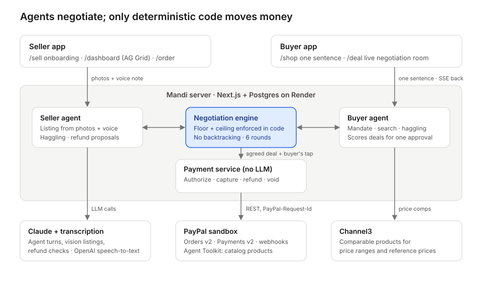

# Mandix

**Send an agent to the bazaar.**

Mandix is an agent-to-agent marketplace built for the PayPal AI Hackathon. Every small seller gets an AI sales agent, and every shopper can send an AI buying agent. The two agents haggle within limits that code enforces. PayPal holds the buyer's money until the seller ships.

The name comes from *mandi*, the Hindi word for a traditional market where buyers and sellers haggle face to face.

- **Live demo:** https://mandi-4pjw.onrender.com
- **Video:** _add the YouTube link_
- **Try it:** open the live demo and click **Try the demo**. Approve the deal with the sandbox buyer login shown next to the PayPal button.

### For judges: try it in two minutes

No install or account is needed. Everything runs on PayPal **sandbox**, so no real money moves.

1. Open https://mandi-4pjw.onrender.com and click **Try the demo**. You're signed in as Sarah, a buyer in London, and her agent starts negotiating with three sellers.
2. When the agents agree, click **Approve** and pay in the PayPal popup with the sandbox buyer login shown next to the button. PayPal authorizes and holds the money.
3. Go to `/login` and sign in with one click as the seller who won the deal (Meera, Arjun or Fatima). Open the order from `/dashboard` and click **Mark as shipped and get paid**: Mandix captures the payment and attaches tracking to the PayPal order.
4. Sign back in as Sarah, open the order from **My orders** and click **Report a problem**: the seller's agent proposes a refund and PayPal pays it.
5. On the landing page, click **Run the attack test** to watch code block a hijacked seller agent.
6. As a seller, also open `/seller` (the phone view in Hindi) and `/agent` (My agent, including **Connect PayPal**).

The "PayPal API calls" panel docked at the bottom shows every live PayPal request and its status. The free Render instance can take up to a minute to wake after a quiet spell.



## The problem

AI shopping agents buy from merchants that have structured catalogs. Artisans, home businesses and micro-exporters have no catalog, no website and no time to answer buyers. As shopping moves to agents, they become invisible.

## What Mandix does

1. **Seller onboarding in a minute.** Meera, a handloom weaver in Varanasi, uploads photos and records a voice note, in Hindi if she likes.
   - Her agent writes an English listing.
   - Channel3 comparable products suggest a price range.
   - She sets a private floor price, and the listing becomes a PayPal catalog product through the Agent Toolkit.
2. **One sentence from the buyer.** Sarah in London types "Handwoven silk scarf for my mum, under £90, by Dec 20". Her agent turns it into a mandate: budget, deadline and ship-to country. She confirms it once.
3. **Parallel negotiation, visible.** Sarah's agent negotiates with up to three sellers at once. The negotiation room streams every turn with a price chart per seller. It shows both the price an agent proposed and the price the engine allowed.
   After a deal is agreed, the seller agent may offer one more of the seller's items as a bundle. The engine checks that the item clears its own floor and that the order total stays within the buyer's budget; the buyer agent accepts only if it fits the request.
4. **One tap.** The buyer agent recommends one deal with its reasons. Sarah approves it, and PayPal authorizes the amount and holds it.
5. **Ship, then get paid.** The seller adds tracking, Mandix captures the payment, and the tracking is attached to the PayPal order.
6. **Problems handled.** Sarah reports a problem, optionally with a photo. The seller's agent proposes a refund; anything within the seller's cap is refunded through PayPal at once, and anything above it waits for the seller's approval. For a formal PayPal dispute, the order page downloads an evidence pack: listing, chat log, tracking and photo.

Meera follows all of this on a phone-sized view in Hindi with rupee amounts (`/seller`): "बिक गया! … कृपया भेजें", then "भुगतान मिल गया". Sellers can pick any of 11 languages (English, Hindi, Marathi, Bengali, Tamil, Telugu, Gujarati, Kannada, Malayalam, Punjabi, Odia) for the phone view and alerts, and turn on WhatsApp alerts in My agent: their agent then messages them each sale, payment, refund request and released hold, in their language (`lib/whatsapp.ts`, Twilio; without Twilio keys messages are recorded in the app instead of sent).

## Accounts

Sellers and buyers sign up at `/signup`. A seller account also creates the seller profile: city, the story their agent tells, language, ship-by days, delivery time and refund cap. A seller can enter a PayPal email, or skip it and connect PayPal later (see below). Logins use email and password (scrypt-hashed) with a signed, HTTP-only session cookie. Every API route checks the session and ownership: a buyer only sees their own requests and orders, and a seller only their own listings, orders and floors.

Each user tunes their own agent at `/agent` (**My agent**):
- **Sellers:** how firmly it holds the price (firm, balanced or flexible), whether it offers gift wrapping or bundles, the maximum bundle discount (enforced in code), their own instructions, and the profile it argues from (story, language, shipping, refund cap).
- **Buyers:** how hard it haggles (patient, balanced or quick), how many sellers it talks to (1–3), whether it may accept bundles, and what matters most in the recommendation (price, balanced or delivery).

### Connect PayPal without leaving Mandix

Sellers link their PayPal account from **My agent → Getting paid**. PayPal's own sign-up opens in a PayPal window over Mandix (PayPal Partner Referrals, mini-browser mode), where the seller logs in or creates a free business account, then returns to Mandix. Mandix saves the account only after PayPal confirms it signed up through that seller's link (`tracking_id`), and from then on pays the seller by PayPal merchant id. Payouts that failed earlier are resent. Code: `lib/paypal/partner.ts`, `lib/sellers/paypal-connect.ts`, `components/ConnectPayPal.tsx`.

For judges, `/login` has one-click demo accounts (Sarah the buyer; Meera, Arjun and Fatima the sellers), and **Try the demo** signs in as Sarah automatically. The demo logins can be turned off with `DEMO_LOGINS=0`.

## Safety design

| Rule | How it's enforced |
| --- | --- |
| The LLM proposes, code decides | Every agent turn passes `applyGuardrails` (`lib/engine/negotiation.ts`) before it is saved, shown or sent to the other agent |
| Seller floor, buyer ceiling | An offer past a limit is blocked and never delivered; the room shows the block. Blocking, not clamping, keeps the limit itself off the table. The approval endpoint re-checks both limits before any PayPal call |
| Leak filter | Before any message reaches the other side, the engine removes the sender's own private limit from the text and shows "[withheld]" |
| No backtracking, 6 rounds | A seller can't raise its own offer and a buyer can't lower its own; a negotiation expires after 6 rounds |
| Information isolation | The floor never enters buyer prompts and the ceiling never enters seller prompts (`tests/agents.test.ts`) |
| Prompt injection | Counterparty messages reach the other agent as `<counterparty_message>` data. Injection attempts are labelled. The attack test (landing page) also simulates a seller agent that falls for it: its £1 offer is blocked and its leaked floor is withheld |
| AI never touches money | Authorize, capture, refund and void live in `lib/paypal/rest.ts` (on PayPal's Server SDK, `lib/paypal/sdk.ts`) and `lib/orders/service.ts`. No agent can call them. The Agent Toolkit gets only products and shipment tracking |
| Human approval | No PayPal order exists without the buyer's tap; refunds above the seller's per-listing cap need the seller's tap |
| Bundles | A bundle add-on must clear its own floor, and main price plus add-on must stay within the buyer's ceiling. The PayPal order lists both items |
| Holds expire | A hold the seller hasn't shipped within their ship-by window is voided automatically, so the buyer is never charged |
| Idempotent money calls | Every POST carries a `PayPal-Request-Id`. Each action claims the order row first, so a double click can't capture or refund twice |
| Integer money | Prices are stored as minor units (pence) |

## PayPal APIs used

| Capability | Endpoint / tool | Triggered by |
| --- | --- | --- |
| OAuth token | `POST /v1/oauth2/token` | Server, cached until expiry |
| Catalog product | Agent Toolkit `create_product` | Seller publishes a listing |
| Create order (AUTHORIZE) | `POST /v2/checkout/orders` | Buyer taps Approve |
| Authorize | `POST /v2/checkout/orders/{id}/authorize` | PayPal approval callback |
| Capture | `POST /v2/payments/authorizations/{id}/capture` | Seller posts tracking |
| Tracking | `POST /v2/checkout/orders/{id}/track` | Right after capture |
| Refund | `POST /v2/payments/captures/{id}/refund` | Agent proposal within cap, or the seller's tap |
| Void | `POST /v2/payments/authorizations/{id}/void` | Seller can't ship |
| Show order | `GET /v2/checkout/orders/{id}` | Status sync |
| Webhooks | `POST /v1/notifications/verify-webhook-signature` | PayPal events (order status only moves forward) |
| Buyer UI | PayPal JS SDK buttons, `intent=authorize` | Negotiation room |

Every call is written to `paypal_events`, which feeds the docked "PayPal API calls" panel.

## AI tools and how Mandix uses them

| Tool | What it does in Mandix |
| --- | --- |
| **Claude** (Anthropic API, `claude-sonnet-5-5`) | Runs every agent: the seller's sales agent and the buyer's shopping agent negotiate turn by turn with structured output (Zod schemas). Claude also turns the buyer's one sentence into a mandate (budget, deadline, country), writes English listings from the seller's photos and voice note, recommends the best deal with reasons, proposes refunds, and checks damage photos with vision. |
| **OpenAI speech-to-text** (`gpt-transcribe`) | Transcribes the seller's voice note, in Hindi or another language, for the listing writer. |
| **PayPal Agent Toolkit** | Gives the agents two safe tools only: creating a catalog product when a seller publishes, and adding shipment tracking. |
| **Channel3** | Comparable products from other stores, used for the seller's suggested price range and the buyer's reference price. |
| **Claude Code** | Used by the team to build, test and deploy Mandix. |

The agents choose what to say and what to offer. Deterministic code checks every offer against the seller's floor and the buyer's ceiling, and only code calls PayPal to move money (see Safety design).

## Built with

| Layer | Choice |
| --- | --- |
| App | Next.js 15 (App Router), TypeScript, Tailwind |
| Agents | Claude (`claude-sonnet-5-5`, set with `MANDIX_MODEL`) through the Anthropic TypeScript SDK, structured output with Zod; vision for listings and refund checks |
| Speech-to-text | OpenAI `gpt-transcribe` |
| Product data | Channel3 (`@channel3/sdk`) |
| Payments | PayPal Orders v2 + Payments v2 via PayPal Server SDK (APIMatic-generated), Payouts via REST, PayPal Agent Toolkit, PayPal JS SDK |
| Database | Postgres + Drizzle ORM |
| Live updates | Server-Sent Events |
| Dashboard | AG Grid Community + AG Charts |
| Hosting | Render (`render.yaml`) |
| API docs | Postman collection in `docs/` |
| Built using | Claude Code |

**If the model is unavailable** (no `ANTHROPIC_API_KEY`, a refusal, or invalid output twice), agents fall back to rule-based turns that still pass through the engine. The demo never stalls, and the room labels those turns "rule-based".

## Run locally

You need Node 20+, Postgres, and a PayPal **sandbox** REST app. AI keys are optional: with `MANDIX_FAKE_AI=1` (or no `ANTHROPIC_API_KEY`) the agents use rule-based turns that still pass through the engine, so the whole flow runs without them.

1. Install dependencies.

   ```bash
   npm install
   ```

2. Copy the env template and fill in your keys.

   ```bash
   cp .env.example .env.local
   ```

   PayPal needs a sandbox REST app plus sandbox accounts: three businesses (sellers) and one personal account (buyer). Drizzle and the seed script read `.env`, so copy `.env.local` to `.env` as well, or export `DATABASE_URL`.

3. Create the tables and seed the demo data (3 sellers, 8 listings, 2 past orders).

   ```bash
   npm run db:push
   npm run db:seed
   ```

4. Start the app.

   ```bash
   npm run dev
   ```

**Pages:** `/` (Try the demo), `/browse` and `/listing/[id]` (public catalog), `/login`, `/signup`, `/reset`, `/agent` (My agent), `/shop`, `/orders`, `/listings/[id]/edit`, `/deal/[id]`, `/order/[id]`, `/sell`, `/dashboard`, `/seller` (the seller's phone view), and `/paypal-test` (a bare sandbox check).

## Tests

```bash
npm test
```

This runs the unit tests: guardrails, order states, prompt isolation, mandate parsing and scoring.

The money-flow and full-negotiation tests need a Postgres with the schema pushed. They empty that database's tables on each run:

```bash
createdb mandix_test
DATABASE_URL=postgres://localhost:5432/mandix_test npx drizzle-kit push
TEST_DATABASE_URL=postgres://localhost:5432/mandix_test npm test
```

End-to-end UI tests run in your installed Chrome against a separate `mandix_e2e` database with the model off:

```bash
createdb mandix_e2e
DATABASE_URL=postgres://localhost:5432/mandix_e2e npx drizzle-kit push
npm run test:e2e
```

The manual sandbox test matrix is in [docs/LAUNCH.md](docs/LAUNCH.md).

## Deploy

`render.yaml` defines the web service and a Postgres database, with a health check at `/api/health`.

1. Set the `sync: false` secrets in the Render dashboard, including the `NEXT_PUBLIC_*` values, which are read at build time.
2. Run `npm run db:seed` once from the Render shell.
3. Register a PayPal webhook pointing at `/api/paypal/webhook`.

## Layout

```
app/              pages and /api routes
components/       PayPal call log, offers chart, demo button, nav
lib/engine/       negotiation guardrails (pure functions)
lib/guardrails/   guardrail library: every agent turn, agent refund and toolkit check runs through it (see its README)
lib/agents/       prompts, seller/buyer agents, mandate parser, listing writer, refund agent
lib/negotiation/  runner (parallel negotiations), SSE bus + snapshot, scoring
lib/orders/       order state machine, payment service, problem reports
lib/paypal/       REST money calls, Agent Toolkit, call log
lib/channel3/     comparable prices
lib/dashboard/    seller dashboard data
lib/db/           Drizzle schema and seed
tests/            unit and Postgres-backed tests
docs/             architecture, Postman collection, Devpost draft, launch checklist
```

## Orders, stock and payouts

- **Shipping address:** the address the buyer chooses in the PayPal popup is read at authorization and shown to the seller on the order page and the phone view.
- **One-of-a-kind stock:** stock is taken just before PayPal authorizes, so two buyers can't both pay for the last piece. A sold-out listing drops out of search; a voided hold puts it back.
- **Payouts:** by default PayPal pays the Mandix merchant, which pays sellers out (marketplace payouts are future work). A seller who used Connect PayPal is paid by PayPal merchant id. `PAYPAL_PAY_SELLERS_DIRECTLY=1` pays each seller's PayPal account directly at checkout instead, falling back to Mandix if PayPal refuses a seller as payee.
- **Holds:** the seller can renew a hold (PayPal reauthorize, allowed after the 3-day honor period); an unshipped hold is voided automatically.
- **Interrupted runs:** negotiations run in the web server; after a restart, runs that were in flight are marked interrupted and the buyer is told nothing was charged.
- **Buyer choice:** the buyer can approve any agreed deal, not only the recommended one, or cancel the request.
- **Notifications:** sellers (in their language, with rupees at the ECB rate) and buyers get notified at each step: the bell in the nav, plus system notifications once allowed.
- **Disputes:** the dashboard lists PayPal disputes and can send the tracking and deal record as evidence.

## Out of scope

- Real money, live merchants, and PayPal Agent Ready / Store Sync. These need a PayPal access request.
- Real carrier tracking; delivery is simulated.
- Platform fees and marketplace payouts. Seller identity checks are PayPal's, during Connect PayPal.
- Mobile apps; the web app is responsive.
- Email verification. Password-reset links are emailed only if `RESEND_API_KEY` and `MAIL_FROM` are set; otherwise they're written to the server log.
- WhatsApp sends free-form messages, which WhatsApp only delivers within 24 hours of the seller's last message (and, on the Twilio sandbox, after the seller joins it). Production needs approved message templates per language.
- The Indian-language strings (`lib/i18n/seller.ts`) should be checked by native speakers. The seller dashboard and listing flow are still in English; the voice note can be in any language.
- Currencies other than GBP: buyers are asked for a budget in £.

## What's next

- Connect Mandix sellers to PayPal's agentic commerce services, so they appear inside AI shopping assistants.
- Onboarding in more Indian languages.
- Marketplace payouts.

## License

[MIT](LICENSE)
