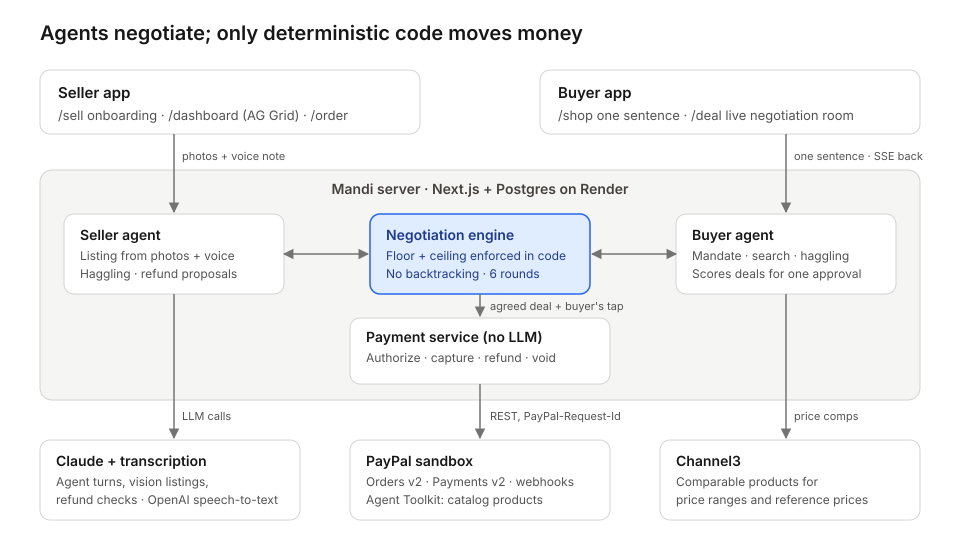

# Devpost submission draft

Fill in the bracketed items, check every claim against the live demo, then paste each section into Devpost.

**Project name:** Mandi
**Tagline (≤ 60 characters):** Your AI shops. Their AI sells. PayPal makes it safe.
**Links:** [Render URL] · [YouTube URL] · [GitHub repo URL]
**Sponsor prizes to tick:** AG Grid, Channel3, Render. APIMatic: Mandi's Orders and Payments calls go through PayPal's Server SDK, which APIMatic generates. Tick it only if the prize's criteria accept that; if they require APIMatic's context plugin, leave it.

## Inspiration

Meera weaves silk in Varanasi. Each scarf takes about four days on the loom, and she sells by word of mouth. AI shopping agents are starting to buy for people, but they buy from merchants with structured catalogs. Meera has no catalog and no website, so as shopping moves to agents she becomes invisible. [Add one impact stat about small sellers or artisans, with its source.]

## What it does

Mandi gives every small seller an AI sales agent and every shopper an AI buying agent. Meera onboards with photos and a voice note; her agent writes the listing and defends her price. Sarah in London types one sentence, and her agent negotiates with three sellers at once, inside limits enforced in code. Sarah approves one deal, and PayPal holds the money until Meera ships.

## How we built it

- **App:** one Next.js and TypeScript app on Render, with Postgres through Drizzle.
- **Agents:** Claude, through the Anthropic SDK with structured output. Vision turns photos into listings and checks damage photos for refunds; OpenAI speech-to-text handles voice notes, including Hindi.
- **Negotiation engine:** a deterministic state machine. Every agent turn passes through it before it is saved, streamed or shown to the other agent.
- **Payments:** PayPal Orders v2 and Payments v2 through PayPal's Server SDK (`@paypal/paypal-server-sdk`, generated by APIMatic), Payouts through REST, plus the PayPal Agent Toolkit for catalog products. Webhooks are verified with PayPal.
- **Price data:** Channel3 comparable products, for the seller's price range and the buyer's reference price.
- **Dashboard:** AG Grid and AG Charts for the seller dashboard.
- **Live updates:** Server-Sent Events for the negotiation room.
- **Development:** built with Claude Code.

## Use of PayPal + AI

| Capability | Endpoint / tool | Triggered by |
| --- | --- | --- |
| Catalog product | Agent Toolkit `create_product` | Seller publishes |
| Create order (AUTHORIZE) | `POST /v2/checkout/orders` | Buyer's one tap |
| Authorize | `POST /v2/checkout/orders/{id}/authorize` | PayPal approval |
| Capture | `POST /v2/payments/authorizations/{id}/capture` | Seller posts tracking |
| Tracking | `POST /v2/checkout/orders/{id}/track` | After capture |
| Refund | `POST /v2/payments/captures/{id}/refund` | Seller agent's proposal within the seller's cap |
| Void | `POST /v2/payments/authorizations/{id}/void` | Seller can't ship |
| Webhooks | `verify-webhook-signature` | PayPal events |

## Agentic commerce

The flow runs from discovery to negotiation to mandate, then authorize, capture on shipment, and refund. The agents decide what to say and what to offer. Deterministic code decides whether a price is allowed and is the only thing that moves money. The agents never get capture, refund or void as tools.

## Safety

- The floor and ceiling are enforced in code on every turn.
- Counterparty messages are passed to each agent as untrusted data.
- No PayPal order is created without the buyer's tap, and refunds above the seller's cap need the seller's tap.
- An offer past a limit is blocked, not clamped, so the limit itself never reaches the other side. A leak filter removes a seller's floor from any message before the buyer's agent reads it.
- The attack test asks the seller's agent for its floor and simulates an agent that falls for it. Its £1 offer is blocked on screen, and its leaked floor arrives as "[withheld]".

## Challenges

- **Capture timing.** PayPal captures most reliably within the 3-day honor period, so Mandi gives sellers a 3-day ship-by window. Reauthorization for slower sellers is future work.
- **A negotiation that's dependable on camera.** Structured outputs, an engine that clamps or rejects bad turns, and a rule-based fallback turn mean a model hiccup never stalls the demo.

## Accomplishments

- The real sandbox money flow works end to end: authorize, capture, track and refund.
- The buyer agent negotiates with three sellers in parallel, live on screen.
- An injection attempt is visibly stopped by code, not by the model behaving.

## What's next

- Connect to PayPal's agentic commerce services (Agent Ready, Store Sync) so Mandi sellers appear in every AI shopping assistant.
- Reauthorize holds for slower sellers.
- Onboarding in more languages.
- Marketplace payouts.

## Try it

- Open [Render URL] and click **Try the demo**.
- Sandbox buyer: shown next to the PayPal button (test money only).
- Seller side: `/sell` and `/dashboard`.
