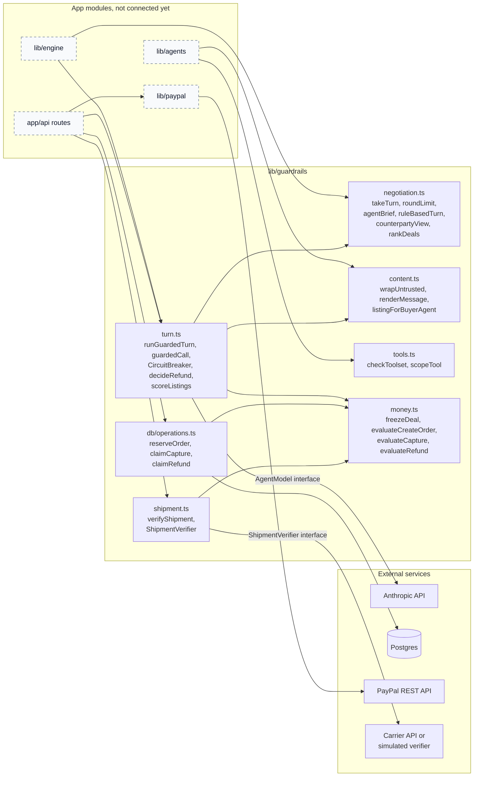
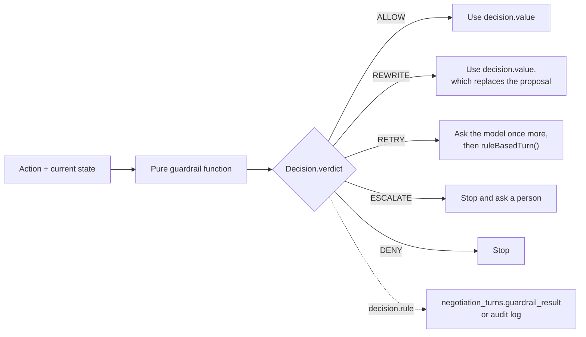
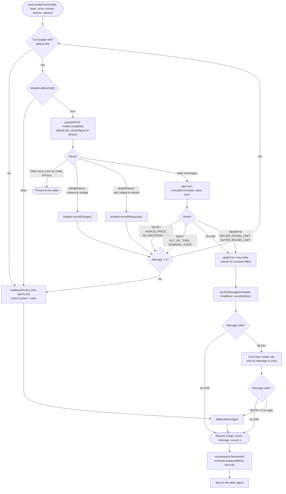
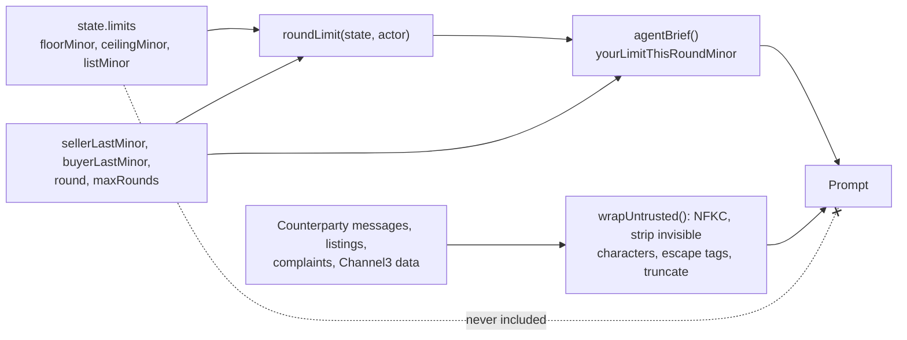
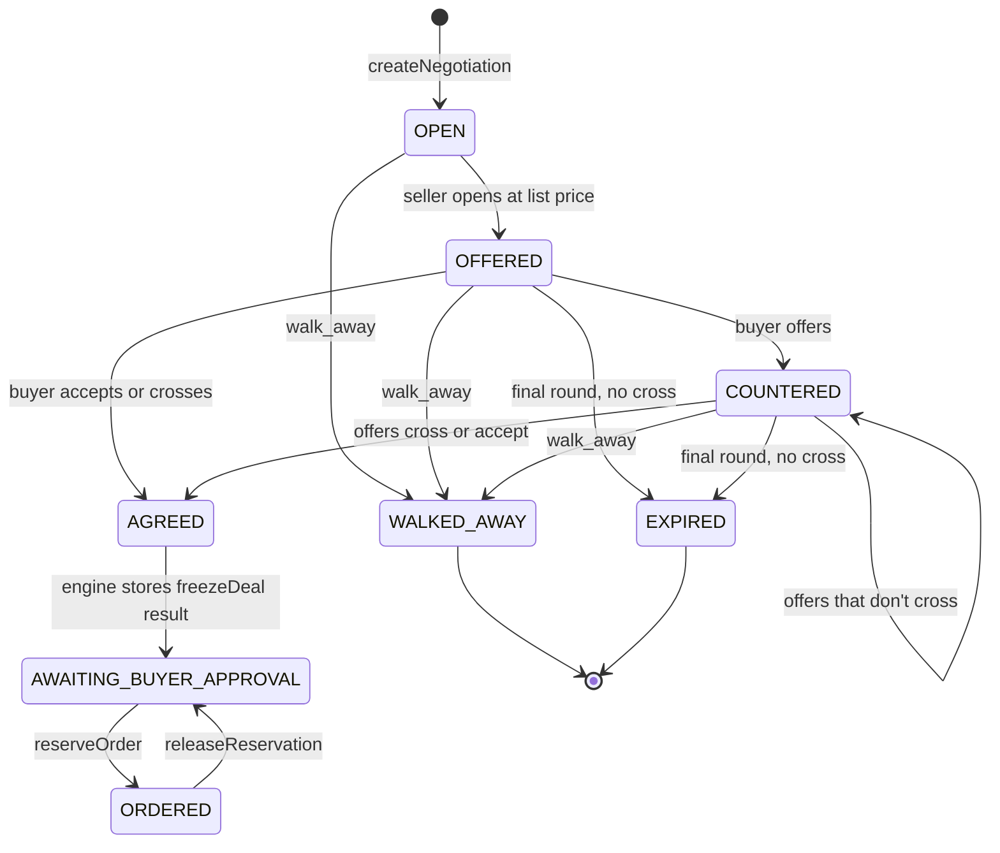
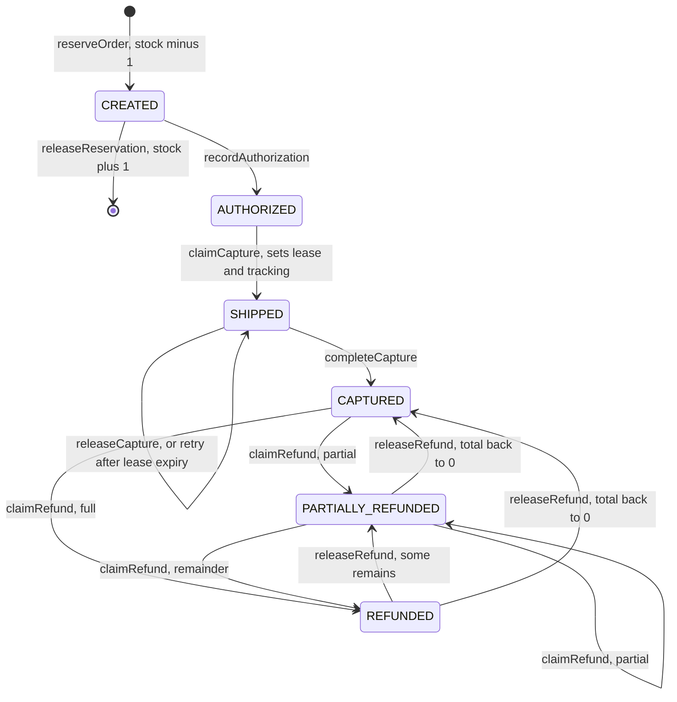
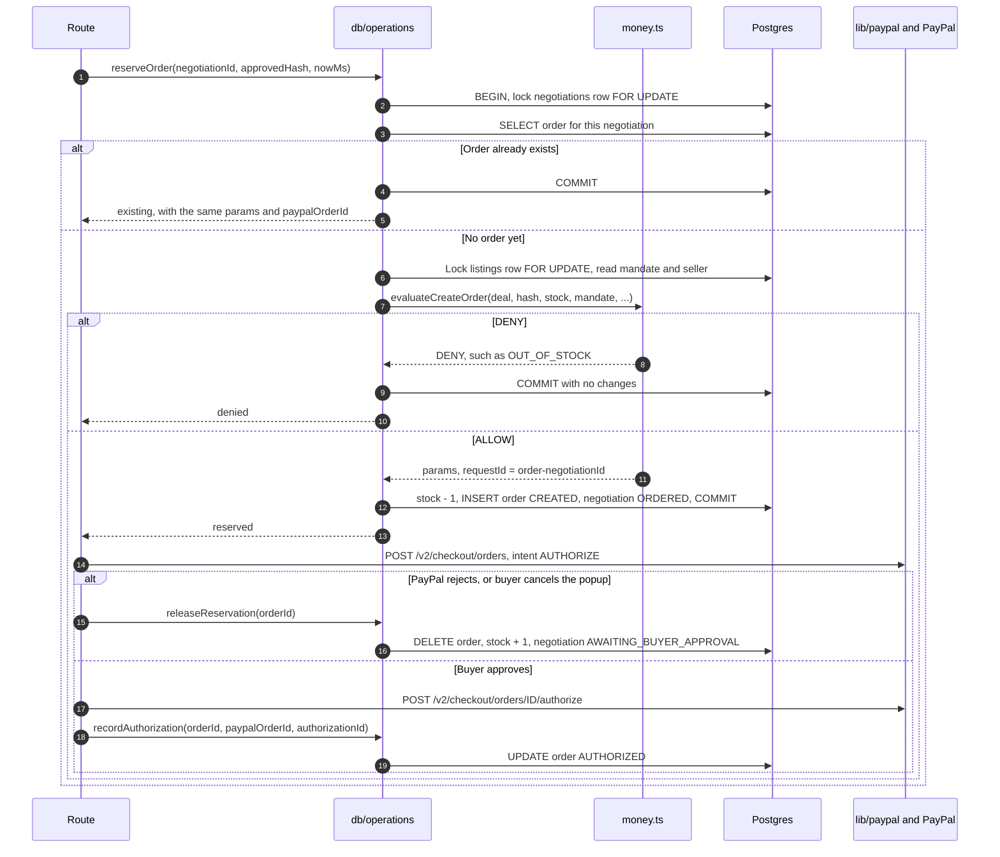
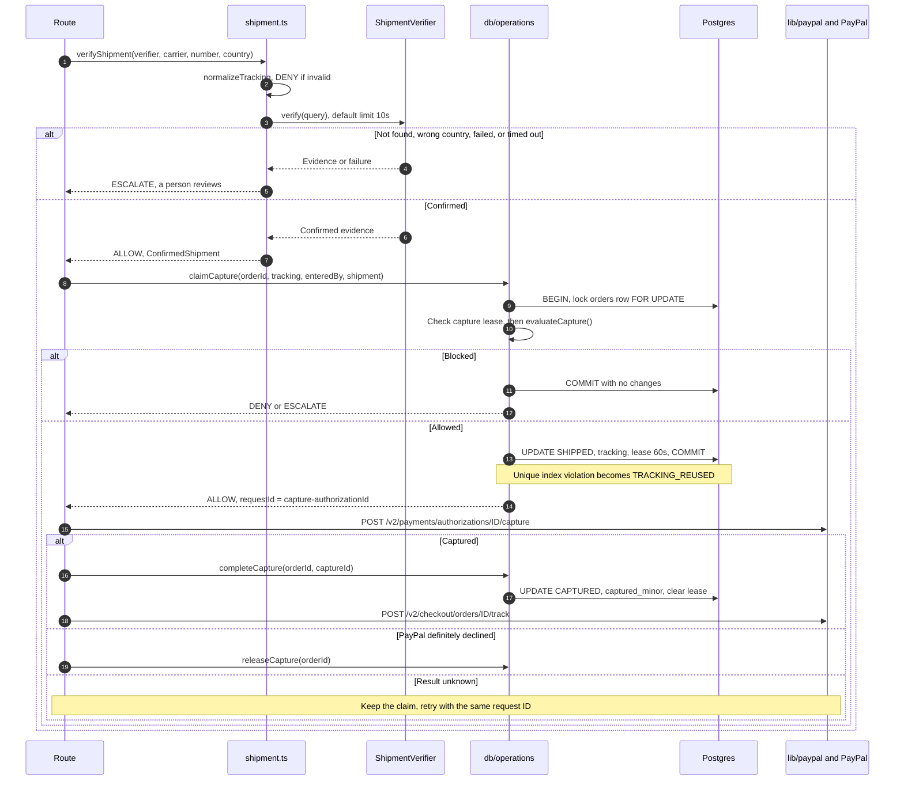
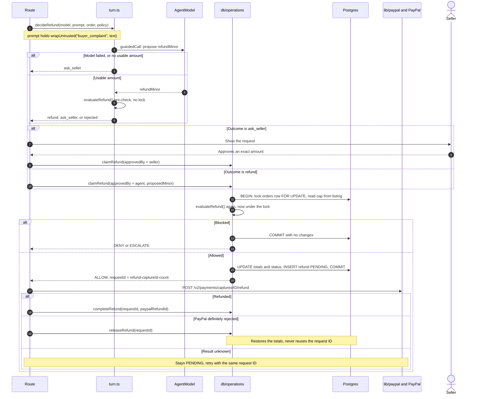

# Guardrails architecture

The technical flows in `lib/guardrails`, using the real function names. For usage, see the [README](README.md). For a plain-language overview, see [How the guardrails work](HOW-IT-WORKS.md).

> **Status:** this library is not connected to the app yet. The running app uses its own guardrails in `lib/engine/negotiation.ts` and `lib/orders/`. This branch only adds the library, and connecting it is a separate decision.

**Built vs planned:** solid boxes in the first diagram are this library, which is tested. Dashed boxes are app modules that exist but don't call this library yet. In the sequence diagrams, `Route`, `lib/paypal`, and PayPal show a possible integration and haven't run with this library.

## 1. Modules and dependencies

Arrows point from the caller to what it uses. Every guardrail module also uses `core.ts`, which holds the `Decision` type, verdict helpers, and money formatting, so those arrows are left out.

## 2. Decision contract

Every check is a pure function that returns the same type. Only `ALLOW` and `REWRITE` carry a value, so callers can't proceed on a blocked action without handling it.

## 3. Negotiation turn: `runGuardedTurn`

### What the model receives

`roundLimit` per actor:

| Case | Seller | Buyer |
|---|---|---|
| First move | `listMinor` | 80% of `ceilingMinor`, at least 1 |
| Normal round | Last offer minus 40% of the gap to the floor | Last offer plus 40% of the gap to the ceiling |
| Final round, floor ≤ ceiling | `min(last offer, midpoint)` | The ask if ≤ ceiling, else `max(last offer, midpoint)` |
| Final round, floor > ceiling | Normal round rule | Normal round rule |

## 4. State machines

### Negotiation

### Order

`APPROVED` and `VOIDED` are in the schema, but no operation sets them yet. `recordAuthorization` also accepts `APPROVED` as a starting state. `BLOCKED_BY_GUARDRAIL` is a valid negotiation status from the plan, and nothing sets it yet.

## 5. Money flows

Every flow uses the same pattern, so a transaction is never held open during a network call:

1. Lock the rows, run the pure rule, and write the claim in one transaction.
2. Call PayPal with a deterministic `PayPal-Request-Id`.
3. Record the result, or release the claim if PayPal definitely rejected it.

### Order creation

Locks are always taken in the order negotiation, then listing, so simultaneous buyers queue rather than deadlock.

### Capture

### Refund

`decideRefund` runs without a lock, so its answer is only a pre-check. The check inside `claimRefund` is the one that counts. An `ask_seller` outcome on an agent proposal must not call `claimRefund` until the seller has approved.

## 6. Database protections

| Protection | Stops | Where |
|---|---|---|
| `SELECT ... FOR UPDATE` | Two requests passing a check at the same time | `db/operations.ts` |
| `orders.negotiation_id UNIQUE` | Two orders for one deal | `db/schema.sql` |
| Partial unique index on `orders.tracking_number` | One tracking number releasing two payments | `db/schema.sql` |
| `CHECK (stock >= 0)` | Overselling | `db/schema.sql` |
| `CHECK (refunded_total_minor <= captured_minor)` | Refunding more than was captured | `db/schema.sql` |
| `refunds.request_id PRIMARY KEY` | Reusing a refund's request ID | `db/schema.sql` |
| `capture_lease_until` | Two captures in flight, and a crash blocking retries forever | `db/operations.ts` |

## 7. Failure handling

| Failure | `FailureKind` | Counts toward breaker | Negotiation turn | Refund | Ranking |
|---|---|---|---|---|---|
| Call exceeds time limit | `timeout` | Yes | Retry, then rules | `ask_seller` | Neutral scores |
| 429, 5xx, or connection failure | `outage` | Yes | Retry, then rules | `ask_seller` | Neutral scores |
| Refusal, invalid JSON, or schema mismatch | `bad_output` | No, and it resets the count | Retry, then rules | `ask_seller` | Neutral scores |
| Breaker open, default 30s after 3 outages | `circuit_open` | No | Rules immediately | `ask_seller` | Neutral scores |
| Bad API key or invalid request | Not a `ModelFailure` | No | Throws | Throws | Throws |
